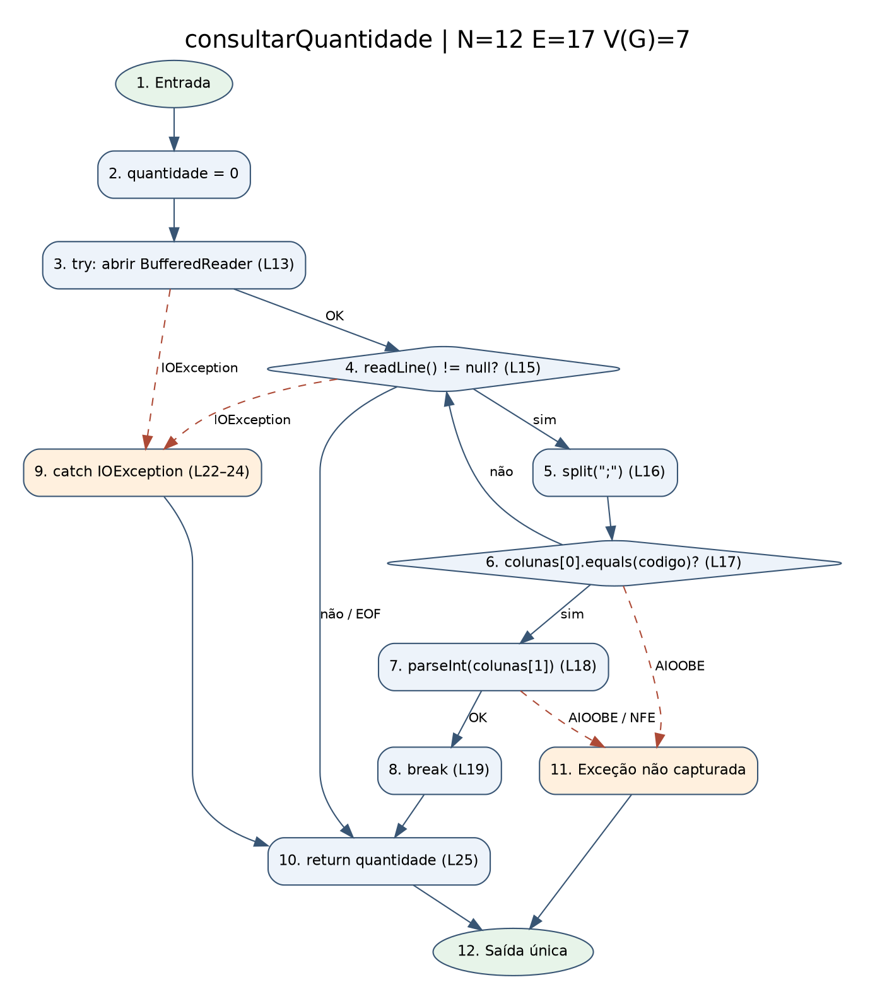
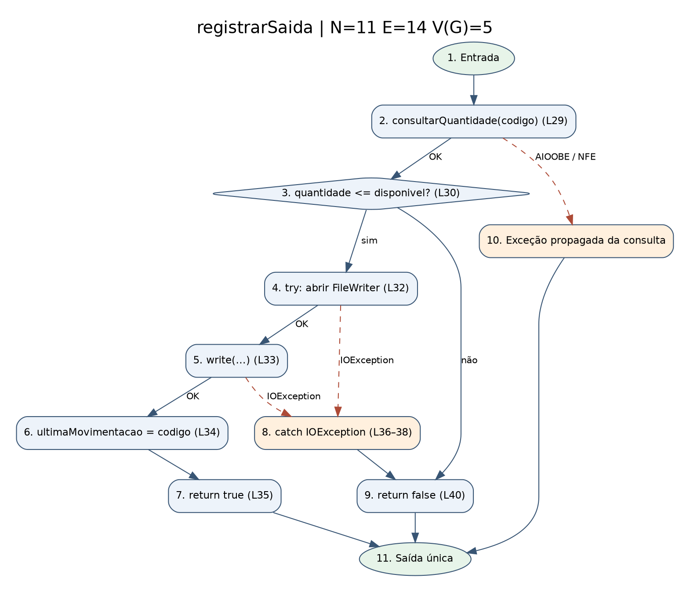

# Atividade de teste de caixa branca — Cenário 2

## 1. Introdução

O cenário analisa a classe Java `EstoqueArquivo`, responsável por consultar quantidades em `estoque.csv` e registrar saídas em `movimentacoes.txt`. O código legado foi transcrito da imagem do enunciado, mantendo a numeração, os comandos e os comentários. A cópia permanece em `original/`. A revisão está em `revisado/`. A atividade examina qualidade, segurança, fluxo de controle, complexidade e testes estruturais.

**Escopo e hipóteses:** o arquivo CSV não possui cabeçalho, contém `codigo;quantidade`, um produto por linha, estoque inteiro não negativo. Considera-se que registrar uma saída deve decrementar efetivamente o saldo; o enunciado não especifica o contrato detalhado de negócio. Adotou-se esse contrato para evitar saídas repetidas acima da disponibilidade. O log registra `codigo;quantidade`, e o getter representa a última saída bem-sucedida na instância, não um histórico persistente. Não se presume autenticação, autorização ou suporte multiusuário.

**Documentação:** o arquivo [PLANO_DE_TESTE.xlsx](PLANO_DE_TESTE.xlsx) utiliza o modelo oficial fornecido na disciplina. A aba CAIXA BRANCA (ESTÁTICO) contém as oito perguntas originais revisadas e 18 ocorrências detalhadas; as demais abas mantêm o conteúdo do modelo. A identificação individual é feita na plataforma de entrega, sem publicar nome ou RA no repositório.

## 2. Execução reproduzível

Requisitos: JDK 17 ou posterior (testado com OpenJDK 21), Python 3 e, apenas para regenerar as imagens, Graphviz (`dot` no PATH). Nenhuma biblioteca Java externa.

Na raiz do repositório:

```sh
java -version
javac -version
python3 testes/executar.py
python3 diagramas/gerar_grafos.py
```

No Windows (PowerShell), a partir da raiz do repositório, execute `py -3 testes/executar.py` (ou `python testes/executar.py`, se esse for o comando disponível). Verifique o código de saída com `$LASTEXITCODE`. No Linux/macOS, use `python3 testes/executar.py` e consulte `echo $?`. A geração dos grafos é opcional para a execução dos testes, pois as imagens já estão no repositório. O programa de testes compila cada implementação separadamente, cria uma pasta temporária por caso, usa dados fictícios, executa a mesma interface pública e compara saída, código de processo, estoque e log com o contrato esperado. Gera `evidencias/execucao.txt` e `evidencias/matriz.csv`. Retorna código 1 se a revisão apresentar alguma falha; falhas esperadas de diagnóstico do legado não interrompem a suíte. O log registra `<classes>` como marcador do diretório temporário de compilação, criado automaticamente pelo script; não é um argumento literal para copiar ao terminal. Para comparar com a execução registrada, confira os identificadores T01–T25 e os campos `esperado` e `observado` nos dois arquivos de evidência.

Para experimentar a revisão sem a suíte, compile a classe e o executor em uma pasta distinta do original. Exemplo em terminal POSIX, a partir da raiz:

```sh
mkdir -p /tmp/estoque-demo/classes /tmp/estoque-demo/dados
javac -encoding UTF-8 -d /tmp/estoque-demo/classes revisado/EstoqueArquivo.java testes/Executor.java
cd /tmp/estoque-demo/dados
printf 'A;10\nB;0\n' > estoque.csv
java -cp ../classes Executor Q:A R:A:5 Q:A U
```

Saída esperada: `Q=10`, `R=true`, `Q=5`, `U=A`. O CSV passa a conter `A;5` e `B;0`; o log contém `A;5`. Para repetir o exemplo, use uma pasta nova ou remova o log de demonstração antes de reiniciar os dados. Não compile as duas classes homônimas no mesmo diretório.

## 3. Análise estática

A aba CAIXA BRANCA (ESTÁTICO) de [PLANO_DE_TESTE.xlsx](PLANO_DE_TESTE.xlsx), com os mesmos dados em [analise_estatica.tsv](analise_estatica.tsv), identifica 18 ocorrências com localização, categoria, severidade justificada, consequência e recomendação. As linhas correspondem exclusivamente à versão original. As classificações adotadas: baixa (manutenção/clareza), média (risco condicionado ou ambiguidade), alta (falha de operação, persistência ou validação), crítica (violação central do controle de estoque). A classificação é qualitativa para este exercício, não uma avaliação CVSS.

Pontos positivos: nomes de métodos em português são compreensíveis, indentação é consistente e há separação inicial entre consultar e registrar. Os principais problemas são a ausência de atualização do estoque (A15), recursos não fechados (A05, A13), exceções silenciadas (A10, A16) e entradas/dados não validados (A03, A06–A08, A12). A concatenação no log (A14) pode comprometer sua integridade, sem alegar exploração remota ou SQL injection (não há SQL). Os testes de regressão comparam o comportamento observável; riscos de concorrência, esgotamento de descritores e durabilidade não foram medidos, conforme a seção 9.

## 4. Grafos de fluxo de controle do original

Convenções: entrada e saída única sintética, blocos sequenciais numerados, decisões em losango, desvios excepcionais tracejados. `break` e `return` possuem arestas explícitas. Não há `switch` no legado; em um eventual switch, a contribuição de um nó seria seu número de saídas distintas menos um, incluindo default quando aplicável. Não se considera o switch do executor. A unidade é o método, não o programa inteiro. O getter está fora do escopo. Uma aresta por origem/destino agrupa exceções que produzem o mesmo fluxo.

São modeladas `IOException` ao abrir e ler o CSV, e ao abrir e escrever o log; `ArrayIndexOutOfBoundsException` (AIOOBE) ao acessar campos de arrays; `NumberFormatException` (NFE) na conversão; e propagação das duas últimas através da chamada em `registrarSaida`. Não foram modelados erros de VM (por exemplo, memória esgotada), `SecurityException` dependente de ambiente ou todas as exceções imagináveis de bibliotecas. O código original não chama `close`, portanto não há aresta de fechamento. Saídas normais e excepcionais chegam ao mesmo nó sintético para a fórmula.

### 4.1 consultarQuantidade



Arestas (origem → destino): 1→2, 2→3, 3→4, 3→9, 4→5, 4→10, 4→9, 5→6, 6→7, 6→4, 6→11, 7→8, 7→11, 8→10, 9→10, 10→12, 11→12.

### 4.2 registrarSaida



Arestas: 1→2, 2→3, 2→10, 3→4, 3→9, 4→5, 4→8, 5→6, 5→8, 6→7, 7→11, 8→9, 9→11, 10→11.

A chamada a `consultarQuantidade` é representada por um nó no segundo grafo. Seus erros de I/O são silenciados no próprio método; o retorno zero pode influenciar a comparação e permitir quantidades não positivas. AIOOBE/NFE atravessam a chamada antes do try de escrita. Não se expande o grafo chamado dentro do segundo, evitando dupla contagem de complexidade.

## 5. Complexidade ciclomática

Para cada método conectado, P=1; V(G)=E−N+2P.

| Método | N | E | P | V(G) | Verificação alternativa |
|---|---:|---:|---:|---:|---|
| consultarQuantidade | 12 | 17 | 1 | 7 | 1 + 1 (abrir) + 2 (while: sim, EOF, IOException) + 2 (if: sim, não, AIOOBE) + 1 (parse) = 7 |
| registrarSaida | 11 | 14 | 1 | 5 | 1 + 1 (chamada) + 1 (if) + 1 (abrir) + 1 (escrever) = 5 |

A segunda verificação usa `1 + soma(grau de saída − 1)` para todos os nós não terminais, incluindo desvios excepcionais; uma decisão com três saídas contribui 2. Se fossem contadas apenas as decisões sintáticas, os valores seriam 3 e 2, respectivamente; não correspondem aos grafos adotados. O script `diagramas/gerar_grafos.py` confirma N, E e o posto dos vetores de incidência de arestas sobre GF(2); resultado em `evidencias/verificacao_grafos.txt`.

## 6. Caminhos básicos independentes

Os identificadores Q e R referem-se a grafos diferentes. Um caminho básico não significa que todo percurso arbitrário do laço foi enumerado. O conjunto abaixo tem 7 e 5 vetores independentes, respectivamente, verificados por eliminação binária. Cada caminho acrescenta pelo menos uma aresta ainda não usada pelos anteriores na ordem exibida (para Q7, a aresta 7→11; para R4, 5→8). O teste T02 combina uma iteração sem coincidência e uma com coincidência, portanto combina segmentos Q3 e Q2, sem ser literalmente a concatenação dos dois caminhos completos.

| ID | Nós | Condição | Caso de teste |
|---|---|---|---|
| Q1 | 1→2→3→4→10→12 | CSV vazio, EOF imediato | T04 |
| Q2 | 1→2→3→4→5→6→7→8→10→12 | Primeira linha corresponde, quantidade válida | T01 |
| Q3 | 1→2→3→4→5→6→4→10→12 | Uma linha não corresponde e depois EOF | T03 |
| Q4 | 1→2→3→9→10→12 | IOException na abertura | T05 |
| Q5 | 1→2→3→4→9→10→12 | IOException na leitura após abertura | Não induzido |
| Q6 | 1→2→3→4→5→6→11→12 | Array vazio após split, por exemplo `;` | T06 |
| Q7 | 1→2→3→4→5→6→7→11→12 | Campo 1 ausente ou conversão inválida | T07, T08 |
| R1 | 1→2→3→4→5→6→7→11 | Quantidade aceita, operações de escrita retornam normalmente | T12, T13, T15–T17 |
| R2 | 1→2→3→9→11 | Quantidade maior que saldo | T14, T20 |
| R3 | 1→2→3→4→8→9→11 | IOException ao abrir log | T18 |
| R4 | 1→2→3→4→5→8→9→11 | IOException durante write, após abertura bem-sucedida | Não induzido |
| R5 | 1→2→10→11 | Exceção não capturada propagada da consulta | T19 |

Q5 e R4 dependem de falhas após abertura bem-sucedida; com arquivos regulares pequenos não são determinísticos. Para simular, em um adaptador de I/O injetável, um Reader cujo `read()` lança IOException após abrir ou um Writer cujo `write()` lança IOException permitiria reproduzir essas condições. No original intacto, a construção direta das classes dificulta essa injeção. Outra alternativa é um sistema de arquivos controlado que falhe após a abertura. Nenhuma dessas simulações foi executada. O plano não afirma 100% de cobertura de arestas; o caminho é inferido a partir da entrada e do código, sem instrumentação. Foram exercitados 10 dos 12 caminhos básicos por condições correspondentes, com Q5/R4 pendentes.

## 7. Matriz de casos de teste e resultados

O esperado representa o contrato adotado para a revisão, aplicado também ao original para diagnosticar seus defeitos, e não o comportamento previsto do legado. `Q` consulta, `R` registra saída, `U` retorna a última movimentação. `null` nos estados dos arquivos indica inexistência, `<DIR>` indica que o caminho aponta para um diretório, `<null>` no argumento representa código Java nulo. `saida` é a lista de linhas do executor, `estoque` e `log` são conteúdos após o teste, `exit` é o código do processo. `ultima` é a condição inicial do objeto. Em todos os casos a instância é nova. Os caminhos indicados dizem respeito ao original; não são identificadores de caminhos na revisão. A matriz completa em CSV e o log de comandos estão em [matriz.csv](evidencias/matriz.csv) e [execucao.txt](evidencias/execucao.txt).

**Resultados observados:** 25 casos executados em cada versão, 4 aprovados no legado e 25 na revisão. Os 21 resultados divergentes do legado não são 21 defeitos distintos; alguns casos demonstram a mesma causa. A aprovação da revisão não implica ausência de defeitos nem cobertura total.

| ID / versão | Método / caminho | Entrada | Pré-condição | Esperado | Observado | Situação / evidência |
|---|---|---|---|---|---|---|
| T01 / original | Q / Q2 | `["Q:A"]` | `{"estoque":"A;10\nB;0\n","log":null,"ultima":""}` | `{"saida":["Q=10"],"estoque":"A;10\nB;0\n","log":null,"exit":0}` | `{"saida":["Q=10"],"estoque":"A;10\nB;0\n","log":null,"exit":0}` | PASSOU — [log](evidencias/execucao.txt) `original-T01` |
| T02 / original | Q / Q3 + Q2 | `["Q:B"]` | `{"estoque":"A;10\nB;0\n","log":null,"ultima":""}` | `{"saida":["Q=0"],"estoque":"A;10\nB;0\n","log":null,"exit":0}` | `{"saida":["Q=0"],"estoque":"A;10\nB;0\n","log":null,"exit":0}` | PASSOU — [log](evidencias/execucao.txt) `original-T02` |
| T03 / original | Q / Q3 | `["Q:A"]` | `{"estoque":"B;0\n","log":null,"ultima":""}` | `{"saida":["EX=NoSuchElementException"],"estoque":"B;0\n","log":null,"exit":0}` | `{"saida":["Q=0"],"estoque":"B;0\n","log":null,"exit":0}` | FALHOU — [log](evidencias/execucao.txt) `original-T03` |
| T04 / original | Q / Q1 | `["Q:A"]` | `{"estoque":"","log":null,"ultima":""}` | `{"saida":["EX=NoSuchElementException"],"estoque":"","log":null,"exit":0}` | `{"saida":["Q=0"],"estoque":"","log":null,"exit":0}` | FALHOU — [log](evidencias/execucao.txt) `original-T04` |
| T05 / original | Q / Q4 | `["Q:A"]` | `{"estoque":null,"log":null,"ultima":""}` | `{"saida":["EX=UncheckedIOException"],"estoque":null,"log":null,"exit":0}` | `{"saida":["Q=0"],"estoque":null,"log":null,"exit":0}` | FALHOU — [log](evidencias/execucao.txt) `original-T05` |
| T06 / original | Q / Q6 | `["Q:A"]` | `{"estoque":";\n","log":null,"ultima":""}` | `{"saida":["EX=UncheckedIOException"],"estoque":";\n","log":null,"exit":0}` | `{"saida":["EX=ArrayIndexOutOfBoundsException"],"estoque":";\n","log":null,"exit":0}` | FALHOU — [log](evidencias/execucao.txt) `original-T06` |
| T07 / original | Q / Q7 | `["Q:A"]` | `{"estoque":"A\n","log":null,"ultima":""}` | `{"saida":["EX=UncheckedIOException"],"estoque":"A\n","log":null,"exit":0}` | `{"saida":["EX=ArrayIndexOutOfBoundsException"],"estoque":"A\n","log":null,"exit":0}` | FALHOU — [log](evidencias/execucao.txt) `original-T07` |
| T08 / original | Q / Q7 | `["Q:A"]` | `{"estoque":"A;abc\n","log":null,"ultima":""}` | `{"saida":["EX=UncheckedIOException"],"estoque":"A;abc\n","log":null,"exit":0}` | `{"saida":["EX=NumberFormatException"],"estoque":"A;abc\n","log":null,"exit":0}` | FALHOU — [log](evidencias/execucao.txt) `original-T08` |
| T09 / original | Q / Q2 | `["Q:A"]` | `{"estoque":"A;10\nA;5\n","log":null,"ultima":""}` | `{"saida":["EX=UncheckedIOException"],"estoque":"A;10\nA;5\n","log":null,"exit":0}` | `{"saida":["Q=10"],"estoque":"A;10\nA;5\n","log":null,"exit":0}` | FALHOU — [log](evidencias/execucao.txt) `original-T09` |
| T10 / original | Q / Q2 | `["Q:A"]` | `{"estoque":"A;-1\n","log":null,"ultima":""}` | `{"saida":["EX=UncheckedIOException"],"estoque":"A;-1\n","log":null,"exit":0}` | `{"saida":["Q=-1"],"estoque":"A;-1\n","log":null,"exit":0}` | FALHOU — [log](evidencias/execucao.txt) `original-T10` |
| T11 / original | Q / Q3 | `["Q:<null>"]` | `{"estoque":"A;10\nB;0\n","log":null,"ultima":""}` | `{"saida":["EX=IllegalArgumentException"],"estoque":"A;10\nB;0\n","log":null,"exit":0}` | `{"saida":["Q=0"],"estoque":"A;10\nB;0\n","log":null,"exit":0}` | FALHOU — [log](evidencias/execucao.txt) `original-T11` |
| T12 / original | R / R1 + Q2 | `["R:A:5","U","Q:A"]` | `{"estoque":"A;10\nB;0\n","log":null,"ultima":""}` | `{"saida":["R=true","U=A","Q=5"],"estoque":"A;5\nB;0\n","log":"A;5\n","exit":0}` | `{"saida":["R=true","U=A","Q=10"],"estoque":"A;10\nB;0\n","log":"","exit":0}` | FALHOU — [log](evidencias/execucao.txt) `original-T12` |
| T13 / original | R / R1 + Q2 | `["R:A:10","Q:A"]` | `{"estoque":"A;10\nB;0\n","log":null,"ultima":""}` | `{"saida":["R=true","Q=0"],"estoque":"A;0\nB;0\n","log":"A;10\n","exit":0}` | `{"saida":["R=true","Q=10"],"estoque":"A;10\nB;0\n","log":"","exit":0}` | FALHOU — [log](evidencias/execucao.txt) `original-T13` |
| T14 / original | R / R2 + Q2 | `["R:A:11","U"]` | `{"estoque":"A;10\nB;0\n","log":null,"ultima":""}` | `{"saida":["R=false","U="],"estoque":"A;10\nB;0\n","log":null,"exit":0}` | `{"saida":["R=false","U="],"estoque":"A;10\nB;0\n","log":null,"exit":0}` | PASSOU — [log](evidencias/execucao.txt) `original-T14` |
| T15 / original | R / R1 + Q2 | `["R:A:0","U"]` | `{"estoque":"A;10\nB;0\n","log":null,"ultima":""}` | `{"saida":["EX=IllegalArgumentException","U="],"estoque":"A;10\nB;0\n","log":null,"exit":0}` | `{"saida":["R=true","U=A"],"estoque":"A;10\nB;0\n","log":"","exit":0}` | FALHOU — [log](evidencias/execucao.txt) `original-T15` |
| T16 / original | R / R1 + Q2 | `["R:A:-5","U"]` | `{"estoque":"A;10\nB;0\n","log":null,"ultima":""}` | `{"saida":["EX=IllegalArgumentException","U="],"estoque":"A;10\nB;0\n","log":null,"exit":0}` | `{"saida":["R=true","U=A"],"estoque":"A;10\nB;0\n","log":"","exit":0}` | FALHOU — [log](evidencias/execucao.txt) `original-T16` |
| T17 / original | R / R1 + Q2 | `["R:A:8","R:A:8","Q:A"]` | `{"estoque":"A;10\nB;0\n","log":null,"ultima":""}` | `{"saida":["R=true","R=false","Q=2"],"estoque":"A;2\nB;0\n","log":"A;8\n","exit":0}` | `{"saida":["R=true","R=true","Q=10"],"estoque":"A;10\nB;0\n","log":"","exit":0}` | FALHOU — [log](evidencias/execucao.txt) `original-T17` |
| T18 / original | R / R3 + Q2 | `["R:A:1","U"]` | `{"estoque":"A;10\nB;0\n","log":"<DIR>","ultima":""}` | `{"saida":["EX=UncheckedIOException","U="],"estoque":"A;10\nB;0\n","log":"<DIR>","exit":0}` | `{"saida":["R=false","U="],"estoque":"A;10\nB;0\n","log":"<DIR>","exit":0}` | FALHOU — [log](evidencias/execucao.txt) `original-T18` |
| T19 / original | R / R5 + Q7 | `["R:A:1"]` | `{"estoque":"A;x\n","log":null,"ultima":""}` | `{"saida":["EX=UncheckedIOException"],"estoque":"A;x\n","log":null,"exit":0}` | `{"saida":["EX=NumberFormatException"],"estoque":"A;x\n","log":null,"exit":0}` | FALHOU — [log](evidencias/execucao.txt) `original-T19` |
| T20 / original | R / R2 + Q3 | `["R:Z:1"]` | `{"estoque":"A;10\nB;0\n","log":null,"ultima":""}` | `{"saida":["R=false"],"estoque":"A;10\nB;0\n","log":null,"exit":0}` | `{"saida":["R=false"],"estoque":"A;10\nB;0\n","log":null,"exit":0}` | PASSOU — [log](evidencias/execucao.txt) `original-T20` |
| T21 / original | R / R1 + Q3 | `["R:Z:0"]` | `{"estoque":"A;10\nB;0\n","log":null,"ultima":""}` | `{"saida":["EX=IllegalArgumentException"],"estoque":"A;10\nB;0\n","log":null,"exit":0}` | `{"saida":["R=true"],"estoque":"A;10\nB;0\n","log":"","exit":0}` | FALHOU — [log](evidencias/execucao.txt) `original-T21` |
| T22 / original | R / R2 + Q4 | `["R:A:1"]` | `{"estoque":null,"log":null,"ultima":""}` | `{"saida":["EX=UncheckedIOException"],"estoque":null,"log":null,"exit":0}` | `{"saida":["R=false"],"estoque":null,"log":null,"exit":0}` | FALHOU — [log](evidencias/execucao.txt) `original-T22` |
| T23 / original | R / R1 + Q2 | `["R:A:1","R:A:2","U","Q:A"]` | `{"estoque":"A;10\nB;0\n","log":"B;2\n","ultima":""}` | `{"saida":["R=true","R=true","U=A","Q=7"],"estoque":"A;7\nB;0\n","log":"B;2\nA;1\nA;2\n","exit":0}` | `{"saida":["R=true","R=true","U=A","Q=10"],"estoque":"A;10\nB;0\n","log":"B;2\n","exit":0}` | FALHOU — [log](evidencias/execucao.txt) `original-T23` |
| T24 / original | R / R2 + Q3 | `["R:BAD;CODE:1"]` | `{"estoque":"BAD:CODE;10\n","log":null,"ultima":""}` | `{"saida":["EX=IllegalArgumentException"],"estoque":"BAD:CODE;10\n","log":null,"exit":0}` | `{"saida":["R=false"],"estoque":"BAD:CODE;10\n","log":null,"exit":0}` | FALHOU — [log](evidencias/execucao.txt) `original-T24` |
| T25 / original | Q / Q2 | `["Q:A"]` | `{"estoque":"A;10;extra\n","log":null,"ultima":""}` | `{"saida":["EX=UncheckedIOException"],"estoque":"A;10;extra\n","log":null,"exit":0}` | `{"saida":["Q=10"],"estoque":"A;10;extra\n","log":null,"exit":0}` | FALHOU — [log](evidencias/execucao.txt) `original-T25` |
| T01 / revisado | Q / Não se aplica ao CFG legado | `["Q:A"]` | `{"estoque":"A;10\nB;0\n","log":null,"ultima":""}` | `{"saida":["Q=10"],"estoque":"A;10\nB;0\n","log":null,"exit":0}` | `{"saida":["Q=10"],"estoque":"A;10\nB;0\n","log":null,"exit":0}` | PASSOU — [log](evidencias/execucao.txt) `revisado-T01` |
| T02 / revisado | Q / Não se aplica ao CFG legado | `["Q:B"]` | `{"estoque":"A;10\nB;0\n","log":null,"ultima":""}` | `{"saida":["Q=0"],"estoque":"A;10\nB;0\n","log":null,"exit":0}` | `{"saida":["Q=0"],"estoque":"A;10\nB;0\n","log":null,"exit":0}` | PASSOU — [log](evidencias/execucao.txt) `revisado-T02` |
| T03 / revisado | Q / Não se aplica ao CFG legado | `["Q:A"]` | `{"estoque":"B;0\n","log":null,"ultima":""}` | `{"saida":["EX=NoSuchElementException"],"estoque":"B;0\n","log":null,"exit":0}` | `{"saida":["EX=NoSuchElementException"],"estoque":"B;0\n","log":null,"exit":0}` | PASSOU — [log](evidencias/execucao.txt) `revisado-T03` |
| T04 / revisado | Q / Não se aplica ao CFG legado | `["Q:A"]` | `{"estoque":"","log":null,"ultima":""}` | `{"saida":["EX=NoSuchElementException"],"estoque":"","log":null,"exit":0}` | `{"saida":["EX=NoSuchElementException"],"estoque":"","log":null,"exit":0}` | PASSOU — [log](evidencias/execucao.txt) `revisado-T04` |
| T05 / revisado | Q / Não se aplica ao CFG legado | `["Q:A"]` | `{"estoque":null,"log":null,"ultima":""}` | `{"saida":["EX=UncheckedIOException"],"estoque":null,"log":null,"exit":0}` | `{"saida":["EX=UncheckedIOException"],"estoque":null,"log":null,"exit":0}` | PASSOU — [log](evidencias/execucao.txt) `revisado-T05` |
| T06 / revisado | Q / Não se aplica ao CFG legado | `["Q:A"]` | `{"estoque":";\n","log":null,"ultima":""}` | `{"saida":["EX=UncheckedIOException"],"estoque":";\n","log":null,"exit":0}` | `{"saida":["EX=UncheckedIOException"],"estoque":";\n","log":null,"exit":0}` | PASSOU — [log](evidencias/execucao.txt) `revisado-T06` |
| T07 / revisado | Q / Não se aplica ao CFG legado | `["Q:A"]` | `{"estoque":"A\n","log":null,"ultima":""}` | `{"saida":["EX=UncheckedIOException"],"estoque":"A\n","log":null,"exit":0}` | `{"saida":["EX=UncheckedIOException"],"estoque":"A\n","log":null,"exit":0}` | PASSOU — [log](evidencias/execucao.txt) `revisado-T07` |
| T08 / revisado | Q / Não se aplica ao CFG legado | `["Q:A"]` | `{"estoque":"A;abc\n","log":null,"ultima":""}` | `{"saida":["EX=UncheckedIOException"],"estoque":"A;abc\n","log":null,"exit":0}` | `{"saida":["EX=UncheckedIOException"],"estoque":"A;abc\n","log":null,"exit":0}` | PASSOU — [log](evidencias/execucao.txt) `revisado-T08` |
| T09 / revisado | Q / Não se aplica ao CFG legado | `["Q:A"]` | `{"estoque":"A;10\nA;5\n","log":null,"ultima":""}` | `{"saida":["EX=UncheckedIOException"],"estoque":"A;10\nA;5\n","log":null,"exit":0}` | `{"saida":["EX=UncheckedIOException"],"estoque":"A;10\nA;5\n","log":null,"exit":0}` | PASSOU — [log](evidencias/execucao.txt) `revisado-T09` |
| T10 / revisado | Q / Não se aplica ao CFG legado | `["Q:A"]` | `{"estoque":"A;-1\n","log":null,"ultima":""}` | `{"saida":["EX=UncheckedIOException"],"estoque":"A;-1\n","log":null,"exit":0}` | `{"saida":["EX=UncheckedIOException"],"estoque":"A;-1\n","log":null,"exit":0}` | PASSOU — [log](evidencias/execucao.txt) `revisado-T10` |
| T11 / revisado | Q / Não se aplica ao CFG legado | `["Q:<null>"]` | `{"estoque":"A;10\nB;0\n","log":null,"ultima":""}` | `{"saida":["EX=IllegalArgumentException"],"estoque":"A;10\nB;0\n","log":null,"exit":0}` | `{"saida":["EX=IllegalArgumentException"],"estoque":"A;10\nB;0\n","log":null,"exit":0}` | PASSOU — [log](evidencias/execucao.txt) `revisado-T11` |
| T12 / revisado | R / Não se aplica ao CFG legado | `["R:A:5","U","Q:A"]` | `{"estoque":"A;10\nB;0\n","log":null,"ultima":""}` | `{"saida":["R=true","U=A","Q=5"],"estoque":"A;5\nB;0\n","log":"A;5\n","exit":0}` | `{"saida":["R=true","U=A","Q=5"],"estoque":"A;5\nB;0\n","log":"A;5\n","exit":0}` | PASSOU — [log](evidencias/execucao.txt) `revisado-T12` |
| T13 / revisado | R / Não se aplica ao CFG legado | `["R:A:10","Q:A"]` | `{"estoque":"A;10\nB;0\n","log":null,"ultima":""}` | `{"saida":["R=true","Q=0"],"estoque":"A;0\nB;0\n","log":"A;10\n","exit":0}` | `{"saida":["R=true","Q=0"],"estoque":"A;0\nB;0\n","log":"A;10\n","exit":0}` | PASSOU — [log](evidencias/execucao.txt) `revisado-T13` |
| T14 / revisado | R / Não se aplica ao CFG legado | `["R:A:11","U"]` | `{"estoque":"A;10\nB;0\n","log":null,"ultima":""}` | `{"saida":["R=false","U="],"estoque":"A;10\nB;0\n","log":null,"exit":0}` | `{"saida":["R=false","U="],"estoque":"A;10\nB;0\n","log":null,"exit":0}` | PASSOU — [log](evidencias/execucao.txt) `revisado-T14` |
| T15 / revisado | R / Não se aplica ao CFG legado | `["R:A:0","U"]` | `{"estoque":"A;10\nB;0\n","log":null,"ultima":""}` | `{"saida":["EX=IllegalArgumentException","U="],"estoque":"A;10\nB;0\n","log":null,"exit":0}` | `{"saida":["EX=IllegalArgumentException","U="],"estoque":"A;10\nB;0\n","log":null,"exit":0}` | PASSOU — [log](evidencias/execucao.txt) `revisado-T15` |
| T16 / revisado | R / Não se aplica ao CFG legado | `["R:A:-5","U"]` | `{"estoque":"A;10\nB;0\n","log":null,"ultima":""}` | `{"saida":["EX=IllegalArgumentException","U="],"estoque":"A;10\nB;0\n","log":null,"exit":0}` | `{"saida":["EX=IllegalArgumentException","U="],"estoque":"A;10\nB;0\n","log":null,"exit":0}` | PASSOU — [log](evidencias/execucao.txt) `revisado-T16` |
| T17 / revisado | R / Não se aplica ao CFG legado | `["R:A:8","R:A:8","Q:A"]` | `{"estoque":"A;10\nB;0\n","log":null,"ultima":""}` | `{"saida":["R=true","R=false","Q=2"],"estoque":"A;2\nB;0\n","log":"A;8\n","exit":0}` | `{"saida":["R=true","R=false","Q=2"],"estoque":"A;2\nB;0\n","log":"A;8\n","exit":0}` | PASSOU — [log](evidencias/execucao.txt) `revisado-T17` |
| T18 / revisado | R / Não se aplica ao CFG legado | `["R:A:1","U"]` | `{"estoque":"A;10\nB;0\n","log":"<DIR>","ultima":""}` | `{"saida":["EX=UncheckedIOException","U="],"estoque":"A;10\nB;0\n","log":"<DIR>","exit":0}` | `{"saida":["EX=UncheckedIOException","U="],"estoque":"A;10\nB;0\n","log":"<DIR>","exit":0}` | PASSOU — [log](evidencias/execucao.txt) `revisado-T18` |
| T19 / revisado | R / Não se aplica ao CFG legado | `["R:A:1"]` | `{"estoque":"A;x\n","log":null,"ultima":""}` | `{"saida":["EX=UncheckedIOException"],"estoque":"A;x\n","log":null,"exit":0}` | `{"saida":["EX=UncheckedIOException"],"estoque":"A;x\n","log":null,"exit":0}` | PASSOU — [log](evidencias/execucao.txt) `revisado-T19` |
| T20 / revisado | R / Não se aplica ao CFG legado | `["R:Z:1"]` | `{"estoque":"A;10\nB;0\n","log":null,"ultima":""}` | `{"saida":["R=false"],"estoque":"A;10\nB;0\n","log":null,"exit":0}` | `{"saida":["R=false"],"estoque":"A;10\nB;0\n","log":null,"exit":0}` | PASSOU — [log](evidencias/execucao.txt) `revisado-T20` |
| T21 / revisado | R / Não se aplica ao CFG legado | `["R:Z:0"]` | `{"estoque":"A;10\nB;0\n","log":null,"ultima":""}` | `{"saida":["EX=IllegalArgumentException"],"estoque":"A;10\nB;0\n","log":null,"exit":0}` | `{"saida":["EX=IllegalArgumentException"],"estoque":"A;10\nB;0\n","log":null,"exit":0}` | PASSOU — [log](evidencias/execucao.txt) `revisado-T21` |
| T22 / revisado | R / Não se aplica ao CFG legado | `["R:A:1"]` | `{"estoque":null,"log":null,"ultima":""}` | `{"saida":["EX=UncheckedIOException"],"estoque":null,"log":null,"exit":0}` | `{"saida":["EX=UncheckedIOException"],"estoque":null,"log":null,"exit":0}` | PASSOU — [log](evidencias/execucao.txt) `revisado-T22` |
| T23 / revisado | R / Não se aplica ao CFG legado | `["R:A:1","R:A:2","U","Q:A"]` | `{"estoque":"A;10\nB;0\n","log":"B;2\n","ultima":""}` | `{"saida":["R=true","R=true","U=A","Q=7"],"estoque":"A;7\nB;0\n","log":"B;2\nA;1\nA;2\n","exit":0}` | `{"saida":["R=true","R=true","U=A","Q=7"],"estoque":"A;7\nB;0\n","log":"B;2\nA;1\nA;2\n","exit":0}` | PASSOU — [log](evidencias/execucao.txt) `revisado-T23` |
| T24 / revisado | R / Não se aplica ao CFG legado | `["R:BAD;CODE:1"]` | `{"estoque":"BAD:CODE;10\n","log":null,"ultima":""}` | `{"saida":["EX=IllegalArgumentException"],"estoque":"BAD:CODE;10\n","log":null,"exit":0}` | `{"saida":["EX=IllegalArgumentException"],"estoque":"BAD:CODE;10\n","log":null,"exit":0}` | PASSOU — [log](evidencias/execucao.txt) `revisado-T24` |
| T25 / revisado | Q / Não se aplica ao CFG legado | `["Q:A"]` | `{"estoque":"A;10;extra\n","log":null,"ultima":""}` | `{"saida":["EX=UncheckedIOException"],"estoque":"A;10;extra\n","log":null,"exit":0}` | `{"saida":["EX=UncheckedIOException"],"estoque":"A;10;extra\n","log":null,"exit":0}` | PASSOU — [log](evidencias/execucao.txt) `revisado-T25` |


## 8. Correções e comparação antes/depois

| Aspecto | Original | Revisado | Evidência |
|---|---|---|---|
| Validação | Aceita zero, negativos e códigos inválidos | Código restrito a letras ASCII, números, `_` e `-`; quantidade positiva | T11, T15, T16, T21, T24 (código inválido isolado, quantidade positiva) |
| CSV | Estrutura, duplicidade e valores não validados | Validação integral, dois campos, quantidade não negativa e código único | T06–T10, T25 |
| Recursos | Leitor e escritor nunca fechados | try-with-resources e UTF-8 explícito | Inspeção do revisado; T12/T23 verificam conteúdo persistido |
| Erros | IOException ignorada, retorna zero ou false | UncheckedIOException com causa; produto ausente em consulta gera NoSuchElementException | T03–T08, T18, T19, T22 |
| Integridade | Não decrementa CSV; log pode ficar vazio | Decremento, log persistido e tentativa de rollback se persistência falhar | T12, T13, T17, T18, T23 |
| Estado | Atualização após write sem confirmar persistência | Atualiza getter após operação de persistência bem-sucedida | T12, T14–T16, T18, T23 |
| Legibilidade | Regras, parsing e I/O misturados | Helpers de validação, leitura e persistência; Paths configuráveis | Inspeção do código |
| Concorrência | Sem coordenação | Métodos sincronizados na mesma instância | Inspeção; não há teste multi-thread |

A revisão lê e valida o arquivo inteiro, de modo que registros inválidos não sejam escondidos pelo primeiro resultado. Para uma saída, prepara o novo CSV em arquivo temporário no mesmo diretório, escreve o log e força a gravação, depois substitui atomicamente o CSV. Se houver IOException durante escrita ou troca, tenta truncar o log ao tamanho anterior; falhas adicionais não são silenciadas (são adicionadas como exceções suprimidas). Se a troca atômica não for suportada, a operação falha em vez de recorrer a uma substituição não atômica. `false` agora significa apenas recusa por ausência/insuficiência; entradas inválidas e falhas de I/O são exceções. A mudança de contrato é intencional e exige adaptação de eventuais chamadores.

Complexidade: foram calculados os valores exigidos para o legado. A revisão distribui responsabilidades entre novos métodos, adiciona verificações e fluxos de erro, portanto não é diretamente comparável apenas pelo V(G) dos dois métodos públicos. Não foi calculado um novo V(G) formal; não se afirma que houve redução. O objetivo é correção e clareza, não minimizar artificialmente decisões.

### Fundamentação das decisões e alcance das evidências

A classificação não decorre apenas do tipo de exceção: considera o impacto no contrato de estoque, a condição necessária para o defeito se manifestar e a possibilidade de distinguir erros de resultados normais. A15 é crítica porque T17 mostra uma violação sequencial da regra central, sem depender de concorrência: duas saídas de 8 foram aceitas com saldo 10. A06/A07 são altas porque o dado malformado interrompe a operação ou é aceito como válido (T06–T08, T19 e T25); A09 é média porque depende da existência de duplicatas (T09). A01 é baixa porque a documentação incompleta não produz, isoladamente, uma falha de execução. A planilha e o TSV apresentam a justificativa individual de cada ocorrência.

- **Validação e contrato (A03, A06–A12, A14):** validar antes da leitura evita que um argumento inválido seja tratado como ausência (T11, T24). Validar o arquivo completo custa uma leitura integral, mas evita que a busca encontre um saldo e ignore registros inválidos posteriores (T09). A escolha de exceções distintas de `false` permite ao chamador separar recusa de negócio de falha operacional; T02/T03/T05 demonstram essa distinção. T24 comprova a validação do delimitador, não uma injeção consumada no legado.
- **Recursos e persistência (A05, A13, A15, A16):** fechar recursos por `try-with-resources` garante fechamento no fluxo normal e excepcional previsto pela linguagem; não se presume que o teste funcional mede vazamento. T12 e T23 verificam os conteúdos dos arquivos, e T17 comprova o decremento em operações sucessivas. T18 verifica falha de abertura do log e preservação de saldo/estado, não o rollback após escrita parcial. A troca atômica limita a janela de CSV parcialmente escrito, mas não torna os dois arquivos uma transação única.
- **Organização e estado (A01, A02, A04, A17, A18):** a divisão em métodos auxiliares torna explícitas as responsabilidades, e caminhos configuráveis permitem isolar testes. O estado só é alterado após persistência bem-sucedida (T12, T15, T16, T18, T23). A sincronização restringe acessos pela mesma instância; concorrência entre processos, exaustão de descritores, variação de charset e métricas de manutenção não foram testadas. Essas melhorias são sustentadas por inspeção, não por medições inventadas.

A regra de decremento, a restrição de códigos ASCII e o contrato de erro foram escolhas de projeto para este exercício. Não são requisitos explícitos adicionais do enunciado. O objetivo é preservar a distinção entre fatos observados, riscos condicionais e decisões justificadas.

## 9. Limitações

- A solução pressupõe acesso local exclusivo por uma instância. A sincronização não protege processos ou instâncias diferentes; caminhos simbólicos/aliases e modificações externas não são tratados como ameaça. Não é um sistema de estoque multiusuário.
- A substituição atômica abrange apenas o CSV. Os dois arquivos não constituem uma transação ACID. Queda do processo, falha no rollback, erro no fechamento após commit ou erro de limpeza do temporário podem deixar estado incerto. O log pode existir vazio após tentativa de rollback. Para garantias fortes, usar banco transacional ou journal com recuperação. Não se alega recuperação de energia ou durabilidade de diretório.
- As entradas de CSV foram pequenas e fictícias; leitura integral aumenta uso de memória com arquivos grandes. Não há suporte a cabeçalho, delimitadores escapados, códigos Unicode ou CSV de uso geral. Formato definido para o exercício.
- Q5 e R4 não foram reproduzidos; não há testes de falha durante rollback, corrida entre processos, exaustão de descritores, `ATOMIC_MOVE` não suportado ou medição formal de cobertura. Testes avaliam resultado e arquivos, não provam ausência de vazamento.
- O legado foi transcrito de uma imagem, não comparado por hash com um arquivo-fonte fornecido. As hipóteses de negócio devem ser confirmadas com o docente. O trabalho deve ser conferido individualmente antes da entrega, inclusive quanto às regras de autoria da disciplina.

## 10. Conclusão e referências

A análise do fluxo permitiu identificar 7 caminhos básicos em consulta e 5 em registro, considerando as exceções explicitadas. Os resultados observados demonstram erros de validação, tratamento de exceções e persistência no código original. A versão revisada passou nos 25 casos executados sob o contrato adotado, incluindo saídas sucessivas e verificação dos arquivos. A solução melhora a confiabilidade local, mas ainda possui limitações de transação, concorrência e cobertura, registradas acima.

Referências: enunciado e imagem do código-base fornecidos pelo professor; fórmula e convenções do próprio enunciado; documentação local e comportamento observado do JDK utilizado. Não foram usados trechos de fontes externas. Ferramentas: Java/JDK, Python 3 e Graphviz.
